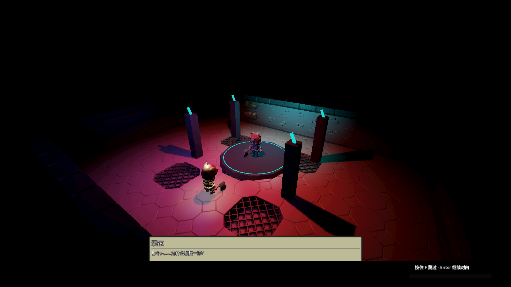
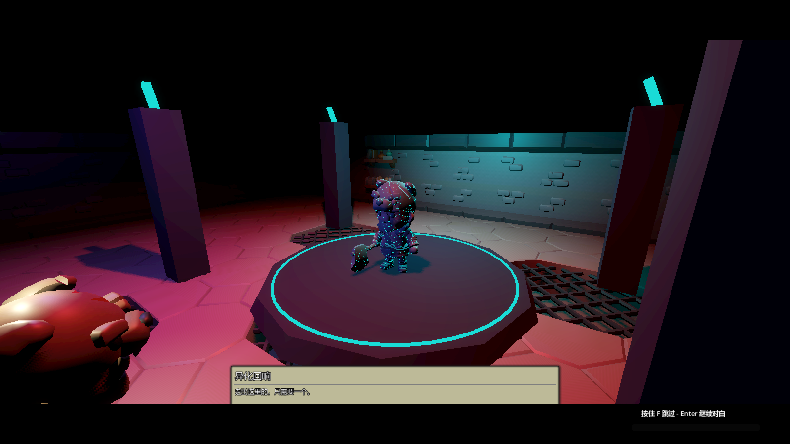

# 老李对话系统

[](https://github.com/LiGameAcademy/laoli_dialogue_system/actions/workflows/validate.yml)
[](https://github.com/LiGameAcademy/laoli_dialogue_system/stargazers)
[](https://github.com/LiGameAcademy/laoli_dialogue_system/releases/latest)
[](LICENSE)

[English](README.md) · [文档目录](docs/README.md) · [MIT 许可](LICENSE)

面向 Godot 的 Resource / JSON 对话、任务、已读历史、变量与局部剧情演出插件。演员、镜头、奖励和剧情提交由宿主负责。

> 想继续学习 Godot、获取更多项目学习资源并参与交流，欢迎加入[老李游戏学院知识星球](https://wx.zsxq.com/group/28885154818841)。

[中文 Discord](https://discord.gg/V5nuzC2BcJ) · [itch.io 主页](https://godot-li.itch.io/) · [B 站主页](https://space.bilibili.com/8618918)

**当前验证环境为 Godot 4.7.2，尚未验证 Godot 4.5。** 仓库根目录即插件目录，不是独立游戏工程。

## 效果预览





截图来自[ARPG示例工程](https://github.com/LiGameAcademy/godot_simple_arpg_demo)：演员、场景和镜头由宿主提供，插件负责对白与演出执行。[截图版本与说明](docs/screenshots/README.md)。

## 功能

- 对话图、选项、条件、动作、本地化键、随机文本和主题化 UI。
- 只读任务配置、独立运行目标，以及宿主显式注册的事件和配置查询。
- 历史记录、存档服务和叙事检查点工具。
- CutscenePlayer 顺序执行片段、对白请求与等待，支持编号回执、超时、跳过、取消和失败。

四文件演出核心可单独接入空工程，不依赖全局对话与任务服务。具体 Boss 演出、战斗、镜头和任务提交规则不包含在插件中。

## 发布与分支

[正式版本 v0.1.0](https://github.com/LiGameAcademy/laoli_dialogue_system/releases/tag/v0.1.0) 是首次正式发布。宿主固定该标签获得可重现的依赖。`master` 为受保护的稳定分支；整合分支在 PR 合并后清理，不作为另一套长期实现。

## 安装

在宿主 Git 仓库执行：

```sh
git submodule add https://github.com/LiGameAcademy/laoli_dialogue_system.git addons/laoli_dialogue_system
git -C addons/laoli_dialogue_system checkout <已验证标签或提交>
git add .gitmodules addons/laoli_dialogue_system
```

宿主提交固定版本指针。其他开发者使用 `git clone --recurse-submodules`，或检出宿主后执行 `git submodule update --init --recursive`。升级需显式选择并验证插件版本。

也可以直接复制到同一路径。启用插件后重新打开 Godot，让相互依赖的服务一同加载。宿主已有 Autoload 会被保留；同名不同实现的冲突应先解决。

## 演出与检查点

实例化 CutscenePlayer 场景，传入 CutsceneDefinition，连接步骤与结束信号。宿主完成对应片段或对白会话后按编号回执；WAIT 自行推进。

完成和跳过可提交预期剧情结果；取消和失败只恢复临时表现与控制。检查点工具负责存储和数据准备，保存时机、版本、剧情标记与角色恢复由宿主定义，不等于完整角色或背包存档。

## 使用文档与验证

[中文使用说明](docs/usage_zh-CN.md) · [安装](docs/installation.md) · [对话与任务](docs/dialogue_and_quests.md) · [演出契约](docs/cutscenes.md) · [检查点](docs/checkpoints.md) · [API](docs/api.md) · [迁移](docs/migration.md)

运行 `python tools/run_tests.py --godot <Godot可执行文件>`。测试使用隔离宿主。具体课程、逐课教程、录制稿和 ARPG 跟做内容保留在教程仓库。
